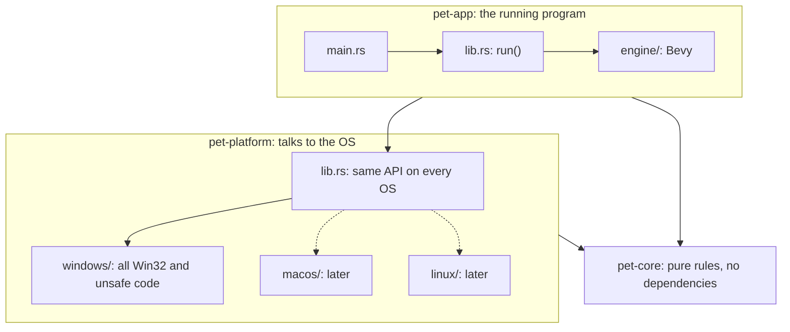
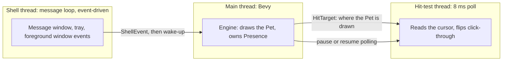

# Proposal: architecture and code structure for roadmap item 2

**Status:** slice 1 is built, and slice 2 is being built from [slice-2-handoff.md](slice-2-handoff.md).

This covers item 2: overlay, click-through, tray, hotkey, autostart and auto-hide. The ground plane and all pet
physics moved to item 4. It's a concrete version of PRD §7.2, built so that other operating systems (Track 7) can
be added later without moving existing code.

## The idea in one paragraph

There are three crates. `pet-core` holds decisions as pure functions and has no OS, Bevy or unsafe code.
`pet-platform` is everything that talks to the operating system. Its `lib.rs` is an OS-neutral API, and all
Windows code sits behind it in `src/windows/`. `pet-app` is the running program and holds Bevy. Because
`pet-platform` doesn't depend on Bevy, the compiler enforces the split. Adding macOS means adding
`src/macos/` with the same API. Replacing Bevy touches `pet-app` only.

## Dependencies point inward



## How the OS is chosen

`lib.rs` compiles one implementation per target and re-exports it, so the rest of the program only ever sees
one API:

```rust
#[cfg(windows)]
mod windows;
#[cfg(windows)]
use self::windows as os;

#[cfg(not(windows))]
compile_error!("Desktop Pet only supports Windows so far (PRD §3)");
```

This is the same shape winit and `tray-icon` use, with one folder per OS behind a shared API. It needs no
Rust traits. The program talks to `pet-platform` through plain types and channels, so in-process tests can
inject a fake `ShellEvent` without any fake platform.

Only the public API is designed to be OS-neutral. Internals such as the hit-test thread stay in `windows/`
for now. They get pulled up when a second OS actually shows what's shared, not before.

## Threads at runtime



- **Main thread:** runs Bevy, keeps the `Presence` value from `pet-core`, and draws the Pet.
- **Hit-test thread:** polls every 8 ms and flips `WS_EX_TRANSPARENT`, separate from the render cap
  (REN-05). This is the one poll we keep. A Pet can move under a resting cursor, and that produces no event
  at all. The event-driven alternative, a global low-level mouse hook, would route every mouse event on the
  machine through this process. While the Pet is Hidden it waits on an event, so it doesn't poll at all.
- **Shell thread:** waits in a message loop and uses no CPU until Windows has something to say, apart from
  one fullscreen re-check every 2 s from slice 3. It keeps running while the engine is stopped, so it's what
  wakes the engine up again. It owns the message window, an invisible Windows window that the hotkey and a second
  launch send to, and the window `tray-icon` creates.

Event hooks and the 2 s re-check both only trigger the same check, so either can be removed later without
touching the other or the rule itself.

`HitTarget` is one value holding the hit mask and placement together. The spike published those separately,
so the hit-test thread could briefly see a new frame with an old position.

## Code structure

```text
Cargo.toml                     workspace; pins bevy to =0.20.1
GLOSSARY.md
crates/
  pet-core/                    #![forbid(unsafe_code)], no dependencies
    src/
      lib.rs
      geometry.rs              Point and Rect in physical pixels
      hit_mask.rs              is this cursor position on an opaque pixel of the Pet?
      presence.rs              Manual hide + Auto-hide => Hidden; hotkey toggle rule
      fullscreen.rs            does the foreground window fill the Home monitor?
  pet-platform/                the OS boundary; no Bevy
    src/
      lib.rs                   the OS-neutral API; picks the implementation
      events.rs                ShellEvent
      hit_target.rs            HitTarget
      windows/                 all Win32 and unsafe code
        mod.rs
        dpi.rs                 physical-pixel awareness
        monitor.rs             Home monitor and work area
        window_styles.rs       Overlay styles, topmost, NonRudeHWND
        hit_thread.rs          8 ms cursor poll
        shell_thread.rs        message loop that hosts the message window and the tray
        tray.rs                tray-icon: Show/Hide, Launch on startup, Quit
        hotkey.rs              RegisterHotKey on the message window: Ctrl+Alt+P
        single_instance.rs     the `Local\DesktopPet` mutex, and asking the first Pet to show
        foreground.rs          event hooks, debounce and 2 s re-check
        autostart.rs           the Run registry value
  pet-app/
    src/
      main.rs                  calls `pet_app::run`, nothing else
      lib.rs                   `run`: startup order, wiring, relaunch after a render failure
      relaunch.rs              start a fresh process, at most 3 times in 10 minutes
      engine/
        mod.rs                 EnginePlugin
        render_config.rs       memory hints, MSAA off, frame cap
        render_config_windows.rs  DX12 and the Visual swapchain
        overlay.rs             the transparent window, starts invisible
        placeholder.rs         stationary procedural art, replaced by content packs in item 3
        presence.rs            applies Hidden: window, camera, update pause
    tests/
      e2e/                     #![cfg(windows)]
        main.rs                the test binary's root
        quiet.rs               tests that leave the mouse alone: `cargo e2e-quiet`
        hands_off.rs           tests that need the real mouse: `cargo e2e` runs these and the quiet ones
        harness.rs             launch and close the exe, restore the cursor, wait_until
        test_window.rs         a plain window that records the clicks it receives
        screen.rs              screen capture, comparison, locating the Pet
.cargo/config.toml             the `cargo e2e` and `cargo e2e-quiet` aliases
.config/nextest.toml           runs e2e tests one at a time
spikes/bevy-overlay/           frozen reference, not in the workspace
```

### The API other code sees

These are the only things `pet-app` can reach in `pet-platform`:

| Item | Purpose |
|---|---|
| `prepare_process()` | OS setup that must run before Bevy starts, such as DPI and the presentation setting |
| `home_work_area() -> Rect` | Where the Overlay goes |
| `acquire_single_instance()` | A guard for the first Pet. A second launch asks the first to show and gets nothing |
| `Platform::start(window, events, wake, tray_icon) -> Platform` | Attaches to the Overlay and starts both background threads |
| `Platform::publish_hit_target(HitTarget)` | Tells the hit-test thread where the Pet is drawn |
| `Platform::set_hidden(bool)` | Pauses or resumes the hit-test thread. Only the engine changes `Window.visible` |
| Dropping `Platform` | Stops and joins the shell thread, which removes the tray icon and frees the hotkey |
| `ShellEvent` | Toggle, Show and Quit. Slice 3 adds "fullscreen changed" |

`pet-core` stays neutral too. The fullscreen rule takes a plain snapshot, such as "client area" and "OS
reports exclusive fullscreen", not Windows constants.

### OS-specific code outside `pet-platform`

There are two deliberate exceptions:
- `render_config_windows.rs` chooses DX12, which is a Bevy setting, so it can't live in `pet-platform`.
- `tests/e2e/` tests the real exe, so it sits with `pet-app`. It drives Windows directly, and a macOS harness
  would be a sibling.

## Testing layers

| Layer | Lives in | Run with | Covers |
|---|---|---|---|
| Pure rules | `pet-core` unit tests | `cargo nextest run` | Hit mask, Presence, fullscreen rule |
| Bevy logic | in-process tests in `pet-app` | `cargo nextest run` | Engine systems, with no window or GPU |
| Real exe, quiet | `crates/pet-app/tests/e2e/quiet.rs` | `cargo e2e-quiet` | What Windows decides, with no mouse |
| Real exe, hands-off | `crates/pet-app/tests/e2e/hands_off.rs` | `cargo e2e` runs these and the quiet ones | Click-through and focus |
| Manual | [manual-checks.md](../manual-checks.md) | by hand | What can't be automated |

The hands-off tests take over the mouse, so nothing else can use the machine during a run. The quiet tests can run
while the owner is working. A forced GPU reset and a real Explorer restart run only when asked for, because they
disturb the desktop. There's no remote yet, so all of this runs locally for now.

The harness finds the Pet without any hooks in the app: it puts a window of one known colour behind the Pet,
and every pixel that isn't that colour is the Pet. This also avoids the spike's blind spot over black
content. So item 2 doesn't need `bevy_remote`. It's worth adding once the Pet moves, behind an `e2e` feature
that a check keeps out of release builds.

Details and sources are in [e2e-testing-and-fullscreen-events.md](../research/e2e-testing-and-fullscreen-events.md).

## Lessons from slice 1

- Anything that changes the Overlay's styles must run on the main thread. Bevy runs systems on worker threads,
  and a style change from one of those waits for the main thread, which is waiting for that system: a
  deadlock on the first frame. `attach_platform` takes a `NonSendMarker` for this reason. The hit-test
  thread can make the same call, but only with the `HitTarget` lock released, because a system on a worker
  thread may be waiting for that lock while the main thread waits for the system.
- winit keeps a tiny helper window that counts as visible, so "the app's visible window" isn't the Overlay.
- Calling `SetLayeredWindowAttributes` isn't needed, even though the Overlay gets the layered style before its
  first show. All real-exe tests pass without it.

## Lessons from slice 2

- Bevy closes a window over two updates, and a Hidden engine runs only when something wakes it, so the second update
  never came and the app ignored `WM_CLOSE`. A close request now exits straight away, the same way Quit does.
- winit notices an exit only when its next message arrives. A stopped engine has none coming, so it slept for ever with
  the exit already requested. Every exit now sends one last wake-up.

- `tray-icon` works off the main thread, checked with a probe before building on it. A tray or menu handler runs on
  the thread that made the icon, and that thread must call `EndMenu` before it stops: an open menu runs its own message
  loop, and without that call the shell thread never got out of it. Stopping it had to be a window message too, because
  that loop only hands on those.
- Nothing can tell from outside that an icon was removed cleanly. `Shell_NotifyIconGetRect` and `NIM_MODIFY` both name
  the icon by its window, and both fail once that window has gone, even with a dead icon still on the taskbar. Measured
  by leaving the icon in place on purpose: the check still passed. So tests only use them while the app runs, and
  whether the shell thread has stopped is checked from inside the process after `pet_app::run` returns.

## Where the spike's code goes

| Spike file | What it does | Where it goes |
|---|---|---|
| `src/hit_mask.rs` (151 lines) | Decides if a screen position is on an opaque sprite pixel. Pure, 6 tests. | `pet-core/src/hit_mask.rs`, nearly unchanged |
| `src/sprite.rs` (75 lines) | Draws the procedural placeholder pet in code. | `pet-app/src/engine/placeholder.rs` |
| `src/main.rs` (398 lines) | Command-line flags, render setup, walking and gravity, drag. | Render setup goes to `engine/`. Walking, gravity and drag are dropped until items 4 and 5. Flags are dropped. |
| `src/win32.rs` (462 lines) | Mixes app code with spike instrumentation. | DPI, work area and hit thread go to `pet-platform/src/windows/`. Styles are rewritten without the `WS_EX_TOPMOST` bit. Metrics, screen capture and the cursor self-test move to the test harness. |

Code gets rewritten test-first as it moves. Nothing is copied wholesale.

## How the three slices map to modules

Module paths under `windows/` are in `pet-platform/src/`.

| Slice | Adds |
|---|---|
| 1. Overlay | `pet-core`: `geometry`, `hit_mask`. `pet-platform`: `hit_target`, and `windows/`: `dpi`, `monitor`, `window_styles`, `hit_thread`. `pet-app`: `render_config`, `overlay`, `placeholder`. |
| 2. Tray, hotkey and autostart | `pet-core`: `presence`, the relaunch limit. `pet-platform`: `events`, and `windows/`: `shell_thread`, `tray`, `hotkey`, `single_instance`, `autostart`. `pet-app`: `engine/presence`, `relaunch`. |
| 3. Auto-hide | `pet-core`: `fullscreen`. `windows/foreground`. |
