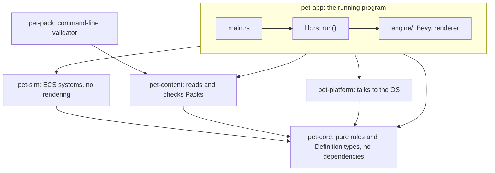
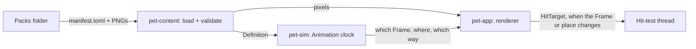

# Proposal: architecture and code structure for roadmap item 3

**Status:** agreed on 2026-11-03. Slices 1, 2 and 3 are built.

This covers item 3: Packs and the renderer, in five slices. It applies the target architecture agreed in the same
session, which is drawn in [docs/architecture/index.html](../architecture/index.html) and recorded in
[ADR-0002](../adr/0002-simulation-in-its-own-ecs-crate.md) and the [PRD](../PRD.md). Words in capitals, such as Pack,
Form, Frame, Anchor, Situation and Emote, are defined in [GLOSSARY.md](../../GLOSSARY.md).

## The idea in one paragraph

The Pet stops being code and becomes a Pack: a folder holding a TOML manifest and one PNG strip per Animation. A new
crate, `pet-content`, reads and checks a Pack, then hands out two things: a Definition made of `pet-core` types, and the
decoded pixels. A second new crate, `pet-sim`, gets the Definition and owns the Animation clock, so it alone decides
which Frame is showing. The renderer in `pet-app` only reads that decision and draws the Frame, at an integer scale,
placed by its Anchor. Nothing flows back from the renderer. The Hit mask follows the Frame the simulation picked, so a
click always lands on what you see.

## Dependencies point inward



- `pet-sim` depends on Bevy's ECS, app and time crates, and not on rendering, so it can't reach the renderer
  ([ADR-0002](../adr/0002-simulation-in-its-own-ecs-crate.md)).
- `pet-content` needs `serde`, `toml` and `png`. All three are already in `Cargo.lock` through Bevy, so nothing new is
  downloaded. They are pinned to the versions there.
- `pet-core` stays free of dependencies. The TOML shape lives in `pet-content` and is converted into `pet-core` types.

## Data flow at runtime



The renderer publishes the Hit target in `Update`, from the Frame and placement the simulation picked. It works out
the placement with the same `pet_core::placement::place` it draws with, so the two can't disagree.

The rule is one-way: data flows from the simulation to the renderer and never back
([ADR-0002](../adr/0002-simulation-in-its-own-ecs-crate.md)).
- **Attack timing and click picking.** The simulation works out the current Frame from the Pack's per-Frame durations.
  So the moment an attack lands, the pixels a click picks, and the Hit mask the Hit-test thread checks all agree with
  the drawn Frame, without asking the renderer.
- **Where the Pet stands.** The simulation places only the Anchor, the point where the feet meet the ground. In item 3
  it stays put at the bottom centre of the work area, because the Ground plane and physics come in item 4. The renderer
  lines up each Frame's Anchor with that point, scales it, and mirrors it to face the other way.

## The Pack format

The placeholder Pack, as it would look:

```toml
format_version = 1
name = "Placeholder dragon"
starting_form = "hatchling"

[forms.hatchling]
cell = { width = 24, height = 18 }        # every Frame of this Form has this size, in art pixels
anchor = { x = 12, y = 18 }               # where the feet meet the ground, from the cell's top-left
body = { x = -9, y = -15, width = 18, height = 15 }   # relative to the Anchor
default_action = "idle"
shadow = { width = 16, colour = "#22203480" }

[forms.hatchling.actions.idle]
animation = "idle"

[forms.hatchling.actions.sleep]
animation = "sleep"
body = { x = -10, y = -9, width = 20, height = 9 }    # curled up: a smaller Body while this Action runs

[forms.hatchling.situations]
held = "idle"
# falling and landing have no art yet, so the default Action plays

[forms.hatchling.animations.idle]
sheet = "hatchling/idle.png"
durations_ms = [250, 250]
markers = [{ frame = 1, name = "footstep" }]

[forms.hatchling.animations.sleep]
sheet = "hatchling/sleep.png"
durations_ms = [600, 300, 600]

[emotes.tired]
sheet = "emotes/tired.png"
cell = { width = 10, height = 10 }
durations_ms = [200, 200, 400]
mode = "looping"                          # or "one-shot"
```

- **Actions are data.** The Mind's choices are named by the Pack. Item 3 only reads which Animation each Action plays,
  and item 4 adds what it scores on and what it does.
- **Situations are the one fixed list:** held, falling and landing. Each Form maps them to its own Animations. A
  Situation with no mapping plays the default Action.
- **Event markers such as `footstep`** are part of the format and get validated, but nothing uses them until sound in
  item 6.
- **The Hit mask** comes from each Frame's transparency, at a threshold of 128. A Pack may set
  `hit_mask_threshold` to change it.

The folder layout:

```text
%LOCALAPPDATA%\DesktopPet\packs\
  placeholder\
    manifest.toml
    hatchling\
      idle.png                 one row of Frames, left to right
      sleep.png
    emotes\
      tired.png
```

- **Which Pack.** The first Pack by folder name is used, and the log says which one. Settings add a real choice in item 6.
- **The development override.** An environment variable, `DESKTOP_PET_PACKS`, points the app at another Packs folder.
- **The repo copy.** The placeholder Pack lives in the repo at `content/placeholder/`. Its PNGs are generated once from
  the ASCII art in today's `placeholder.rs`, which then goes.

## Validator rules

The validator reports **every** error, each with the file and the field it's about, and never stops at the first. A
Pack loads completely or not at all. With no valid Pack the app shows no Pet, writes the errors to `desktop-pet.log`,
and keeps the tray icon so you can still quit. `pet-pack validate <folder>` prints the same list.

1. **The manifest file.**
   - `manifest.toml` exists and is valid TOML.
   - `format_version` is one this build understands.
   - Unknown fields are rejected.
2. **Forms.**
   - There is at least one Form, and `starting_form` names one of them.
   - Each Form has a `default_action` that is in its own list of Actions.
3. **Actions and Animations.**
   - Every Action names an Animation of the same Form.
   - Every Animation is used by at least one Action or Situation of its Form. An unused Animation is an error,
     because it's usually a typo.
4. **Situations.**
   - Only `held`, `falling` and `landing` are allowed.
   - Each one names an Animation of the same Form.
   - A missing Situation is allowed.
5. **Sheets.**
   - Every sheet exists and is a PNG with transparency.
   - Each sheet is exactly one cell high, and as wide as the cell times its number of durations.
6. **Durations.** There is one duration per Frame, and each is above 0 ms.
7. **Anchor and Body.**
   - The Anchor lies inside the cell or on its edge. It's measured between pixels from the cell's top-left, so x goes
     from 0 to the width and y from 0 to the height.
   - Every Body has a positive width and height.
   - A per-Action Body belongs to an Action that exists.
8. **Hit masks.**
   - Every Frame has at least one pixel at or above the threshold, or the Pet couldn't be clicked.
   - The threshold is between 1 and 255.
9. **Markers.** Each marker names a Frame that exists in its Animation.
10. **Emotes.**
    - Each Emote has a unique name, a sheet that passes rules 5 and 6 against its own cell, and a mode of `one-shot` or
      `looping`.
    - Emotes are optional.
11. **Names.** Names are unique within their list.

## Code structure

New files are marked **new**. Everything else already exists.

```text
Cargo.toml                       adds pet-content and pet-sim; pins serde, toml and png to the lockfile versions
content/
  placeholder/                   new: the placeholder Pack, a real Pack
crates/
  pet-core/
    src/
      pack.rs                    new: the Definition types: PackDefinition, FormDef, ActionDef, AnimationDef, EmoteDef,
                                 Situation, and small number ids interned from Pack names
      animation_clock.rs         new: which Frame shows after a given time, looping or one-shot
      placement.rs               new: Anchor position, scale and facing become a hit_mask::Placement; the Ground plane
      shadow.rs                  new: slice 3, the shadow's ellipse and where it goes on the Ground plane
      hit_mask.rs                unchanged
  pet-content/                   new crate
    src/
      lib.rs                     load(folder) -> LoadedPack or every error; discover(packs folder)
      manifest.rs                the TOML shape, read with serde, turned into pet-core types
      validate.rs                the rules above
      images.rs                  PNG decoding, splitting strips into Frames, Hit masks
      watch.rs                   slice 5: tells the app when a Pack's files change
      bin/pet-pack.rs            `pet-pack validate <folder>`
    tests/
      packs/                     good and broken Packs as fixtures
  pet-sim/                       new crate
    src/
      lib.rs                     SimPlugin
      phases.rs                  the system sets Sense, Interpret, React, Decide, Act, Resolve, Present, chained
      pack.rs                    the current Definition as a shared resource; PackReloaded
      clock.rs                   advances each Animation clock; holds time while Hidden
      emotes.rs                  ShowEmote and HideEmote; one-shot and looping
  pet-platform/
    src/
      windows/mod.rs             adds packs_folder() next to log_file_path()
  pet-app/
    src/
      lib.rs                     loads the Pack before the engine starts
      engine/
        pack_assets.rs           new: turns the pixels into Bevy images
        renderer.rs              new: draws the Frame the simulation picked; publishes the Hit target
        shadow.rs                new: slice 3
        pixel_art.rs             new: slice 3, draws everything as a unit quad with a ColorMaterial, not a Sprite
        emote_view.rs            new: slice 4
        tray_icon.rs             new: the app's own icon, so the tray works with no Pack
        placeholder.rs           removed
    tests/
      e2e/                       new tests that write Packs into the test's own Packs folder
```

## The API other code sees

| Item | Purpose |
|---|---|
| `pet_platform::packs_folder()` | `%LOCALAPPDATA%\DesktopPet\packs`. The app checks `DESKTOP_PET_PACKS` first |
| `pet_content::discover(folder)` | The first Pack by folder name, or none |
| `pet_content::load(pack_folder) -> Result<LoadedPack, Vec<PackError>>` | All or nothing. `LoadedPack` holds the `PackDefinition` and the pixels |
| `pet-pack validate <folder>` | Prints every error. Exits non-zero if there are any |
| `pet_core::pack::PackDefinition` | Read-only, shared through an `Arc`. The simulation never sees pixels |
| `pet_core::animation_clock` | Given the durations, whether it loops and the time played, returns the Frame. Pure |
| `pet_core::placement::place(...)` | Anchor position, Form, scale and facing become the `Placement` the Hit mask already uses |
| `pet_sim::SimPlugin` | Adds the phases, the clock and the Emote systems |
| `pet_sim::{Pet, Position, Faces, ShownFrame}` | What the renderer reads: where the Anchor is, which way the Pet faces, and the Frame the clock picked |
| `pet_sim::Hidden` | Set by the app from Presence. The clock holds while it's `true` |
| `ShowEmote`, `HideEmote`, `PackReloaded` | Messages, read once in a later phase |
| `Platform::publish_hit_target(HitTarget)` | Unchanged. Now fed from the Frame the simulation picked |

## The five slices

| Slice | Adds | Modules | Done when |
|---|---|---|---|
| 1. Pack, loader and validator | The Definition types, `pet-content`, `pet-pack`, the placeholder Pack, the app's own tray icon | `pet-core/pack`, `pet-content/*` except `watch`, `pet-app/engine/pack_assets`, `tray_icon` | `pet-pack validate content/placeholder` passes. The app loads the Pack at startup and the Pet looks and moves exactly as today. A broken Pack shows no Pet, logs every error, and the tray still quits |
| 2. Simulation, clock and renderer | `pet-sim` with its phases, the Animation clock, the renderer, Anchor placement | `pet-core/animation_clock`, `placement`, `pet-sim/*` except `emotes`, `pet-app/engine/renderer` | The Pet plays its default Action on a loop, timed by the Pack's per-Frame durations, at 2× integer scale, placed by its Anchor. The Hit mask follows the simulation's Frame. Hidden freezes the clock, so the Pet doesn't jump on waking <br>**Built.** The app tells the simulation it's Hidden through `pet_sim::Hidden`. The simulation then pauses Bevy's virtual clock, so the time spent Hidden is never added and the fixed clock has nothing to catch up on |
| 3. Drop shadow | The shadow under the Anchor, with width and colour from the Pack | `pet-core/shadow`, `pet-app/engine/shadow`, `pet-app/engine/pixel_art` | The shadow draws under the feet and never catches clicks <br>**Built.** The shadow is a pixel-art ellipse, one texel per Pack pixel, drawn at the Pet's 2x on its own entity behind the Pet. It's `width` Pack pixels wide and a quarter of that high, rounded half up and at least 2, so 30 x 8 for Brim. It's centred on the Anchor's x, with an odd width's extra texel on the right so it stays on the Pet's texel grid. Its bottom row ends on the Ground plane, `placement::ground`, which `home` also uses, because the Overlay stops there. A Form with no shadow hides it, and it's redrawn only when the Form, the Anchor or the Ground plane changes. The Hit target is unchanged by it. **Not `Sprite`:** on DX12 a `Sprite` after the first draw call lands in the wrong place, so the Pet and its shadow are each a unit-quad `Mesh2d` with a `ColorMaterial`, through `engine/pixel_art`, which Emotes will use too ([Sprites on DX12](../research/simulation-architecture.md#sprites-on-dx12)). **Colour:** half-transparent pixels blend in sRGB, as an image editor shows them, through `CompositingSpace::Srgb` on the camera. A shadow pixel is left premultiplied in sRGB, `c x a`, and the window's compositor adds what's behind, so `#1a132660` over magenta should show as (169, 7, 173), within 2. Bevy's default, linear light, would have shown (172, 8, 180). An unrun real-exe test checks it. **Known limitation:** an odd-width shadow keeps its extra texel right of the Anchor when the Pet is mirrored, so it sits half a texel off the mirrored Pet's centre |
| 4. Emotes | The Pack's Emote library, `ShowEmote` and `HideEmote` | `pet-sim/emotes`, `pet-app/engine/emote_view` | A one-shot Emote plays once and vanishes. A looping one stays until hidden. It sits above the top of the Body, never catches clicks. Headless and windowless render tests cover it until item 4 sends it |
| 5. Hot reload | The Pack watcher | `pet-content/watch`, `pet-sim/pack` | Windows reports file changes, with no polling. A valid edit replaces the Pack and sends `PackReloaded`. An invalid one keeps the old Pack and logs the errors |

Each slice is built test-first and ends with its tests passing. A manual check is added only where a test can't see
the result.

## Testing layers

| Layer | Lives in | Run with | Covers |
|---|---|---|---|
| Pure rules | `pet-core` unit tests | `cargo nextest run` | Definition types, Animation clock, placement |
| Pack loading | `pet-content` unit tests and fixture Packs in `tests/packs/` | `cargo nextest run` | Every validator rule, all-or-nothing loading, choosing the first Pack |
| Simulation | headless `pet-sim` tests with manual time. `MinimalPlugins` is in the full `bevy` crate, so they add its task pool and time plugins themselves | `cargo nextest run` | The clock, phase order, Emotes, swapping a reloaded Pack |
| Windowless render tests | `crates/pet-app/tests/render/`, at most 8 at once through a nextest test group | `cargo nextest run` | Exact Frame pixels, integer scale, Anchor, shadow, Emotes |
| Real exe | `crates/pet-app/tests/e2e/` | only when the owner starts them, see below | Startup with a good or broken Pack, transparency and click-through for the new Hit target, hot reload |
| Manual | [manual-checks.md](../manual-checks.md) | by hand | What no test can see |

The harness already gives each real-exe test its own `LOCALAPPDATA` folder. A test can therefore write a Pack into
`<that folder>\DesktopPet\packs\` and launch the app, with no test code in `src/`.

### Tests that run in the background

The owner's rule, from 2026-11-03: tests that run while the owner is doing something else take no screenshots, show
nothing on screen and touch neither the mouse nor the keyboard. Tests that do any of that are fine, but only when the
owner starts them.

So `cargo nextest run` holds everything that can run any time, including the windowless render tests. Every real-exe
test is something the owner starts, because a running exe always shows something, even if only its tray icon.

The windowless render tests draw into an image in memory and compare every byte, with no window at all.
[windowless-render-tests.md](../research/windowless-render-tests.md) measured about 1 s per test, and no gain beyond 8
at once. They don't cover the window itself: transparency, click-through and the swapchain stay with the real-exe tests.

To need no test code in `src/`, `pet-app` exposes these pieces, and `engine::app()` is built from them:

| Item | Purpose |
|---|---|
| `PetRenderPlugin` | Draws the Pet the simulation shows into whatever camera exists |
| `pet_camera()` | The camera's components, `(Camera2d, Msaa::Off)` |
| `base_plugins()` | The render setup without a window, with pipelined rendering off |
| `render_plugin()` | The render settings inside `base_plugins()`. A render test sets synchronous shader compiles on top of them, which the app doesn't need |
| `PackAtStartup`, `StartingPack` | How the app hands the Pack it loaded to the engine. A render test hands over its own |

The app adds the window, `SimPlugin` and a camera on the window. A render test adds `SimPlugin` and a camera aimed at
an image.

Housekeeping at the start of slice 1: `cargo e2e-quiet` comes to mean "shows things, sends no input". The hotkey test
types a real Ctrl+Alt+P through `SendInput`, so it moves to `hands_off.rs` and `cargo e2e`. The README says plainly that
both suites are for the owner to start, and what each does to the screen.

## Out of scope

- Behaviour, the Mind, and what Actions score on (item 4).
- Physics, the Ground plane, falling and landing (item 4).
- Interactions such as throwing, petting and pokes (item 5).
- Settings, a scale setting, choosing a Pack, saving, and sound, including the event markers (item 6).
- The real dragon (item 7).
- Encounters and everything on the Physics & hits tab beyond the Hit mask (Track 3).
