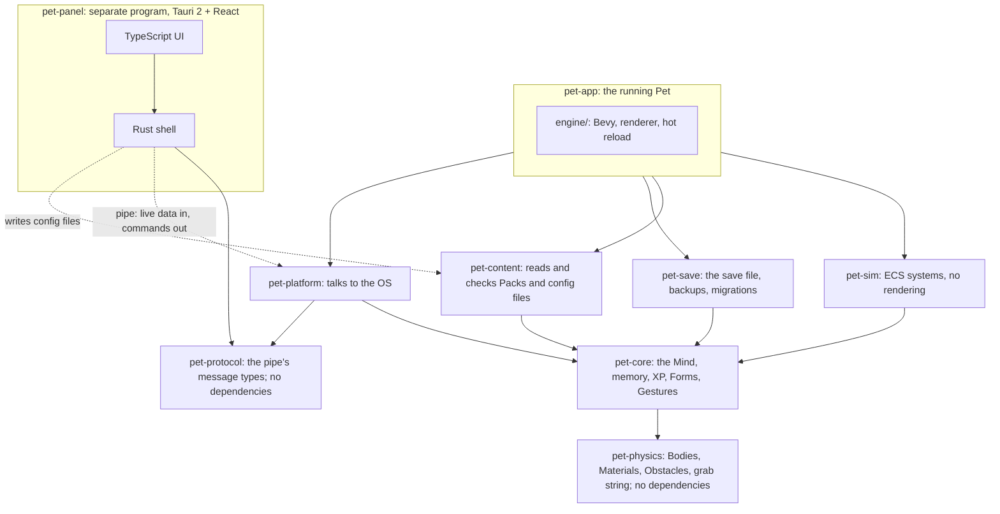
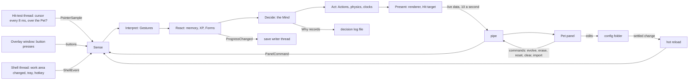

# Proposal: architecture and code structure for roadmap item 4

**Status:** agreed on 2026-11-06, in a design session over twelve rounds. Not yet built.

Item 4 is "The living Pet, in nine slices". It replaces the old items 4, 5 and 6, so that the owner can interact with
the Pet and save it early, and can check each system by hand as it lands. The old item 7, the real character, becomes
item 5 and runs alongside. The slices are drawn on the "MVP slices" tab of
[docs/architecture/index.html](../architecture/index.html). Three ADRs record the decisions that are hard to reverse:
[ADR-0003](../adr/0003-own-physics-with-a-grab-string.md) for physics,
[ADR-0004](../adr/0004-pet-panel-as-a-separate-program.md) for the Pet panel and
[ADR-0005](../adr/0005-a-learning-mind-with-reasons.md) for the learning Mind. Words in capitals, such as Gesture,
Material, Obstacle, Link, Experiment and Marker, are defined in [GLOSSARY.md](../../GLOSSARY.md). The research behind
the choices is in [docs/research/](../research/). Where it disagrees with this proposal, this proposal wins (see the
section near the end).

## The idea in one paragraph

The Pet gets a body, a memory and a Mind, in an order that lets the owner play with it from the first slice. A new
crate, `pet-physics`, moves upright Bodies with gravity, Materials and a springy grab string, so the owner can grab,
swing and fling the Pet and watch it land. A second new crate, `pet-save`, keeps the Pet across restarts in one JSON
file. Gestures (poke, stroke, drag, Marker) are recognised in `pet-core`, and the Pet reacts, hatches, and earns XP for
them. A separate small program, the Pet panel, shows what the Pet is thinking and edits the files that tune it, which
reload while the Pet runs. Finally the Mind arrives: drives and traits from the Pack, a tree of utility choices, a
two-speed memory, and learned Links, so the Pet does more of what goes well and can always say why.

## Principles

These apply to every slice and every later track.

1. **Emergence.** Actions and mechanics are authored, and general. How they combine is learned. No Action, rule or
   chain exists for only one scenario. A new mechanic is judged on whether it composes with the others: smash damage,
   for example, would come from the physics fall speed, not from a "smash after throw" rule.
2. **Every choice has a "why".** Each decision traces back to named causes: drives, traits, memories, Links or an
   Experiment. The Pet panel can show them. Deep neural networks stay out of the Mind for now, and we revisit that if
   the Pet's intelligence falls short ([neural-mind.md](../research/neural-mind.md)).
3. **Experiments are labelled.** Pillar 1 becomes: *"When it experiments it shows it (❓), its experiments stay within
   limits and fade as it learns, and nothing it does goes unexplained."* The dice come from a seed saved in Progress, so
   a test or a replay gives the same result.
4. **Packs are data, mechanisms are Rust.** Drives, traits, Actions, Materials, the Mind tree and the event table are
   Pack data. Node kinds, effect kinds, Feature kinds and the physics are a closed list in Rust. There is no scripting.
5. **Never in the way.** No popups, no sounds by default, Emotes only when a reason starts or changes, and no
   Experiments or Evolutions during a focus session.

## Dependencies point inward



- `pet-physics` has no dependencies at all. It owns the geometry types (`Point`, `Rect`) that `pet-core` has today in
  `geometry.rs`, and `pet-core` re-exports them, so existing code keeps compiling. `pet-core` then has no *external*
  dependencies, instead of none.
- `pet-save` owns the file's own types and the chain of migrations. `pet-core` never reads or writes a file.
- `pet-panel` is not a workspace member that the Pet links against. It's a separate program in `panel/`, built with
  `pnpm`. Its Rust shell shares only the pipe's message types, from `pet-protocol`.
- `pet-protocol` holds only those message types, the live data and the commands, and depends on nothing in the
  workspace. `pet-platform` runs the pipe itself, and the panel's Rust shell talks to it, so neither side pulls in
  the other's code.

## Data flow at runtime



- **Input.** The Hit-test thread already polls the cursor every 8 ms. It now also passes each position on, with
  whether it's over the Pet's pixels. The Overlay window receives the button presses, because it only catches clicks
  over the Pet anyway. While a button is held, the Overlay keeps the mouse, so a fast drag can't drop the Pet when the
  cursor slips off its edge. Sense reads all of it once a tick, and reads idle time (`GetLastInputInfo`) once a tick
  too. There is no global mouse hook.
- **Work area.** The shell thread tells the engine when the work area changes, for example when the taskbar is
  resized, moved or auto-hidden. The Overlay resizes, and the Pet falls onto the new Ground plane, or is pushed up
  onto it.
- **One way, as before, with one narrow exception.** The renderer only reads. The panel reads live data, edits files
  that hot-reload, and sends a small closed set of commands, which Sense reads like any other input. Nothing else
  flows back into the tick, apart from the Gestures the owner makes.

## Physics (slice 1)

Everything is measured in physical screen pixels, so a throw feels the same at 1× and at 4×. Bodies are upright
rectangles that never rotate, so the Hit mask, the shadow and the Emotes are unaffected.

- **Gravity, the release speed cap and ground friction** are app-wide numbers in `balance.toml`. The cap starts at about
  2,500 px/s; a hard swing reached about 2,700 px/s in the spike.
- **The grab string.** While the owner holds the Pet, a short springy string with damping pulls the grab point
  towards the cursor. Moving slowly, the Pet trails. A quick flick stretches the string and catapults it. Circles swing
  it around the cursor. Letting go keeps whatever speed it had. There is no throw/drop threshold. The string's length
  and springiness are feel numbers in `balance.toml`. The Pet plays its `held` Situation while held.
- **What it collides with.** The Home monitor's left, right and top edges, the Ground plane, and every Obstacle, on all
  four sides, so the Pet can land on top of one. A swept test stops a fast Pet passing through a thin Obstacle.
- **Materials.** Each surface and each Body has a Material: friction and bounciness. A Form gives its Body one. An
  Action or a Situation can override it while it runs. When two Materials touch, friction is averaged and the bouncier
  one wins, unless an override says otherwise. An override always wins, so a landing that never bounces works even on
  a bouncy floor.
- **Landing.** Every landing plays `landing`. A landing above a speed records an "impact" event that memory and XP use.
- **Measured** in [physics-rotation.md](../research/physics-rotation.md), headless: 0.2 µs a tick for one Pet, 190 µs
  for 1,000 boxes. Results were bit-identical across runs and processes, on this one machine only.

## The Pack format additions

`format_version` stays 1 through the MVP. Each slice that adds fields updates the validator, the placeholder Pack,
Brim's `export.py` and `pet-pack validate` together. Unknown fields are still rejected. An excerpt:

```toml
# Slice 7: the Character's drives and traits. Names are the Pack's own; the core supplies the dynamics.
[drives.energy]
rest = 0.7                                  # where it settles
rise_per_min = 0.02
fall_per_min = 0.05
pushed_by = { sleep = 0.3, run = -0.1 }     # Actions and event kinds that push it

[traits]
playful = 0.8
bold = 0.4

# Slice 1: a Material per Form, optional.
[forms.egg]
material = { friction = 0.6, bounciness = 0.1 }

# Slice 4: what an Action does, and when it may run.
[forms.hatchling.actions.pounce]
animation = "pounce"
tags = ["play"]
effects = [{ jump = { up = 500, toward = "cursor" } }]
# No "during": like every Action, it runs on the ground.

[forms.hatchling.actions.brace]
animation = "landing"
tags = ["air"]
during = ["falling"]                        # slice 7: it may also run in these Situations
material = { bounciness = 0.0 }             # override while it runs: a landing that never bounces

# Slice 4: which Action plays for each Gesture, until the Mind takes over in slice 7.
[forms.hatchling.reactions]
poked = "poke"
stroked = "petted"

# Slice 8: what each kind of event means to this Character.
[events.thrown]
valence = 0.2                               # how pleasant; also the reward signal for learning
arousal = 0.6                               # how stirring
memorability = 0.5
measure = "release_speed"                   # a raw size, for records and "monumental" salience

[events.petted]
valence = 0.8
arousal = 0.2
memorability = 0.3

# Slice 7: the Mind. The MVP has one utility choice; other node kinds are additions, not a rewrite.
[mind]
format = 1
root = "alive"

[[mind.nodes]]
id = "alive"
kind = "utility"
options = { tags = ["idle", "move", "rest", "play"] }

[forms.hatchling.actions.sit]
tags = ["rest"]                             # memory consolidates during Actions tagged rest
considerations = [
  { input = "drive.energy", bookends = [0, 1], curve = "falling" },
  { input = "since_last.sit", bookends = ["0s", "5m"], curve = "rising" },
]

# Slice 7: Emotes tied to reasons. Shown when the reason starts or changes, never constantly.
[emote_reasons]
tired = { drive = "energy", below = 0.2 }
curious = "experiment"
love = { opinion = "owner", rises_by = 0.2 }
annoyed = { reaction = "annoyed" }
```

- **Actions are general building blocks.** The effect kinds are a closed Rust list: walk to a target, jump, show an
  Emote, and later attack. Tags let one utility choice pick from every Action with a tag, so an Action a Pack adds
  joins the Mind as plain data.
- **Situations.** Held, falling and landing stay the fixed list. Every Action runs on the ground. From slice 7, an
  Action can also list in `during` the Situations it may run in. While the Pet is held or falling, the Mind chooses
  among those Actions. If none suits, the Situation's Animation plays as it does now.
- **New validator rules.** Drive and trait names are unique, and every name a consideration or `pushed_by` uses
  exists. Reactions name Actions of the same Form. Every `during` names a Situation. The Mind has no cycles, every node
  id exists, and each Form can reach at least one Action. Every tag a choice uses matches an Action. Event kinds name
  a known `measure`. Material values are between 0 and 1. A Mind with no variety, so the Pet would do one thing for
  ever, gets a warning, not an error.

## The config folder

Files the owner may edit live in `%LOCALAPPDATA%\DesktopPet\config\`, a folder of their own, so the log's constant
writes never wake the watcher. The Pet panel edits the same files, so editing by hand and editing in the panel go
through the same validation and the same error messages. Each file loads completely or not at all. An invalid edit
keeps the old values and logs every error.

```toml
# balance.toml: every feel number and the XP matrix. These are starting values, tuned by hand.
[physics]
gravity = 3000                 # px/s²
max_release_speed = 2500       # px/s
ground_friction = 0.8
grab = { length = 24, stiffness = 400, damping = 30 }

[xp]
level_curve = "100 * level^1.5"   # total XP for each Level; data, shown in the panel

[[xp.rules]]
source = "petted"              # any memory event kind
base = 5
modifiers = [{ when = "personal_best", times = 2 }]
diminishing = { full_per_hour = 5, then = 0.5 }
cap = { per_hour = 50 }
enabled = true

[[xp.rules]]
source = "hatched"
base = 100
cap = { once = true }

[memory]
consolidation_timer = "2h"     # background consolidation; turn it down to speed it up
dormant_cap = 5000

# obstacles.toml: rectangles in physical pixels on the Home monitor, drawn as faint outlines, click-through.
[[obstacle]]
rect = { x = 1600, y = 1500, width = 40, height = 500 }
material = { friction = 0.1, bounciness = 0.0 }   # a wall to slide down

# settings.toml: written by the panel's Settings tab in slice 9, and readable by hand.
scale = 2
home_monitor = "primary"
activity = 1.0
launch_on_startup = true
hotkey = "Ctrl+Alt+P"
return_delay = "2s"                         # how long after a fullscreen app leaves before the Pet comes back
sound = { on = false, volume = 0.5 }
rhythm_learning = true
decision_log = true
developer_tab = false
```

Mind edits the owner makes later go into a per-Character override, `config\minds\<character>.toml`, applied over the
Pack's Mind. The Pack stays as its author made it, and the owner's edits survive Pack updates. What the Pet learned is
a third layer, kept in Progress, never in a file the owner edits.

**Hot reload is one system.** A data source registers three things: how to read and check its file, all or nothing;
how to swap the result in, in an exclusive system before the ticks and the renderer; and how to report errors. The
watcher, the 250 ms settle wait, the background read, the wake-up and applying edits in the order they arrived are
written once. The config folder gets one watch, and when a burst settles, only the files whose size or write time
changed are read again. Slice 5 moves the Pack onto this system first, so its existing tests prove the move changed
nothing. The save file is not hot-reloaded: the app owns it.

## The save file

One JSON file per installation, in `%LOCALAPPDATA%\DesktopPet\save\`, readable as plain text:

```json
{ "format": "desktop-pet-save", "version": 1, "crc32": "9f3a…",
  "data": { "position": { "x": 1920, "y": 2056 },
            "characters": { "Brim": { "form": "hatchling", "unlocked": ["egg", "hatchling"],
                                      "left_starting_form": true, "ledger": { "total": 340, "by_source": {} },
                                      "memory": {}, "learned": {}, "seed": 1234, "ticks": 98000 } } } }
```

- **Writing.** Changes are gathered on `ProgressChanged` and written at most 2 s after the first one, and at once on
  quit or hide. A writer thread keeps only the newest snapshot, writes it to a temporary file, flushes it to disk and
  renames it over the old one, so a crash can't leave half a file. A power cut can lose at most those 2 s.
- **Backups.** A copy at each launch and once a day. The last 3 launch copies and the last 7 daily copies are kept. A
  file that fails its checksum or its schema is moved aside, never overwritten, and the next copy is tried. If every
  copy fails, the Pet starts as a fresh egg, the tray says what happened, and the broken files stay.
- **Migrations** are a chain of pure functions from one version's file types to the next, each tested against a fixture
  file. Every slice that adds a saved field adds a migration and a round-trip test.
- **Measured** in [persistence.md](../research/persistence.md) at 5,000 memory records: JSON loads in 3.2 ms and saves
  in about 6 ms. SQLite is worth revisiting if the file passes about 10 MB, about 50,000 records, or if memory must be
  searched without loading it all.
- **Progress per Character** holds the current Form, the unlocked Forms (they only grow), whether the Pet has left its
  starting Form (which closes item 3's `starting_form` gap), the Ledger (it only grows), the memory including the
  episode buffer, the learned Links, the Experiment seed and the tick count.

## Memory and learning (slice 8)

- **One way in.** Every source sends the same `MemoryEvent`: an event kind, up to two subjects, an intensity and a time.
  A new kind of event is a new row in the Pack's event table plus the Rust that sends it. Memory and the save format
  don't change.
- **Two speeds.** A 64-slot episode buffer, saved, runs on simulation ticks, so it freezes while Hidden. Each event
  moves a two-number mood, a fast opinion per subject (`cursor`, `owner`), familiarity and "time since" counters.
  Lasting opinions and up to 16 landmark episodes form during Actions tagged `rest`, and on the background timer.
  Long-term values run on the real calendar. Negative ones fade; fondness never fades while the owner is away. The
  lasting opinion of the owner never goes below neutral.
- **Monumental events last longer.** A first-ever event, one far above the usual, or a personal best stretches how long
  it's felt, up to 8×, and how strongly it's learned, up to 2×. Records go in their own table.
- **Names, not numbers.** Entries store Pack names through one name table per Character. A name a reloaded Pack no
  longer has goes dormant: kept, with no effect, back when the name returns. Dormant entries are capped by count,
  5,000 to start. A slice 8 test fills memory to the cap and checks the save's real size and load time against the
  budget, and the log warns when dormant entries pass 1,000, so we learn the real numbers.
- **Links between memories.** Through shared names, plus a few explicit links such as "evidence for". An episode cited
  in a "why" is copied into a small store, so the reason survives when the buffer wraps.
- **Learning.** The reward is an event's `valence`, credited to what the Pet did 0.3–4 s before. Rewards count only
  above the owner's usual rate. The Pet learns Links over a shared list of Features: in this context, after this
  Action, that tends to follow. Experiments come from the seed, are driven by where learning is fastest, only pick
  options scoring at least half the best, show ❓, are capped (hatchlings more, adults less, about one per 5 minutes on
  the desktop to start) and never run during focus. The Marker, a middle click on the Pet, starts out meaningless: the
  Pet learns its value by noticing that marked moments are followed by petting. Learned values stay inside limits the
  Pack sets. Links are keyed by Action name, so knowledge carries over when the Pet evolves.
- **The MVP taste:** the Pet learns which of its Actions the owner rewards, in which context, does them more, and says
  why: "I sit here because you petted me the last 4 times". The planner that chains Links into Routines is Track 1.
- **Cost, estimated, not measured:** memory about 1–3 µs a tick and about 15 KB per Actor; learning about 1–6 µs a
  tick and 10–120 KB per Character.

## The Mind (slice 7)

- **A tree of utility choices.** The MVP's tree is one `utility` node. `priority`, `sequence` and `states` are later
  additions for enemies and bosses, in the same format. Considerations read drives, traits, memory, Features,
  "time since" and `time_of_day`.
- **When it decides:** when the current Action ends, at once when something happens (a Gesture, a landing, the end of
  a Situation), and on a slow beat of about once a second. It switches only if the new choice beats the current one by
  a margin. The beat, the margin and the activity level are balance numbers.
- **Why records.** Every decision returns its causes. A ring of recent records feeds the Pet panel. A local decision log
  records each change of Action with its reasons: an estimated 50–300 KB a day, kept 30 days, never leaving the
  machine, on by default and switchable in Settings.
- **Emotes as reasons**, from `emote_reasons`, at most as often as a balance number allows.

## The Pet panel (slice 6 onwards)

A separate program, `pet-panel`: Tauri 2, TypeScript, React, and React Flow for the later Mind editor, with `pnpm`. The
tray and the right-click menu start it, and only one runs at a time. While it's open, the Pet sends live data through
a named pipe, a private local channel that Windows restricts to the owner's account, about 10 times a second.

The panel changes things in two ways:
- **Files** for what the owner configures: settings, balance and Mind overrides. The panel writes the file, and hot
  reload applies it, exactly as a hand edit would. Export is a copy of the save file.
- **Commands** over the same pipe for what the Pet itself owns: evolve, erase a Link, reset learning, reset the Rhythm,
  clear the decision log, and import a save. The list is closed and lives in `pet-protocol`. The Pet carries each one
  out inside its tick and replies with the result, such as "imported" or the reason it refused. These can't be file
  edits: the Pet writes its save every 2 s, so only the Pet can swap it or change it safely.

When it closes, nothing of it stays in the Pet. Measured with the comparable separate egui program, the Pet was back
at about 96 MB after closing; WebView2 measured about 87 MB while open. While open, the budget is a guideline of
about 200 MB and 2 % CPU (§6.2).

Tabs arrive with their slices: Progress (XP by source, the next Evolution, an Evolve button) and Balance in slice 6,
Mind in slice 7, memory and "what I've learned" in slice 8, with erasing one Link or resetting all learning, and
Settings in slice 9. A Developer tab is switched on in Settings.

## The right-click menu (slice 5)

A native Windows menu, like the tray's, restyled after the MVP: "Brim · Level 3 · 40 / 120 XP", **Evolve** (only
while an Evolution is ready), **Pet panel…**, **Hide**, **Quit**. A level-up shows a short Emote if the Pack has one,
and a log line. There's no popup or sound. Brim's level-up Emote is an art request for item 5.

## Code structure

New files are marked **new**. Names are proposals and may change while building.

```text
crates/
  pet-physics/                 new crate, no dependencies
    src/geometry.rs            Point and Rect, moved from pet-core
    src/body.rs                Body, Motion, Material, combine rule and overrides
    src/world.rs               Ground plane, screen edges, Obstacles; step and swept collision
    src/grab.rs                the springy grab string
  pet-core/src/
    gesture.rs                 new: poke, drag, stroke, Marker, poke combos
    action.rs                  new: timing and effects
    form_graph.rs              new: Evolutions, FormProgress
    xp.rs                      new: XP rules, level curve, Ledger
    drives.rs, mind/           new: drives, traits, the tree, utility scoring, Why records
    memory/, learning/         new: MemoryEvent, episodes, opinions, landmarks, Features, Links, Experiments
    pack.rs                    gains drives, traits, Materials, reactions, events, the Mind, emote_reasons
  pet-save/                    new crate: file types, migrations, writer thread, backups
  pet-protocol/                new crate, no dependencies: the pipe's live data and the closed command set
  pet-content/src/
    config.rs                  new: balance.toml, obstacles.toml, settings.toml, Mind overrides
    manifest.rs, validate.rs   the new Pack fields and rules
  pet-sim/src/
    input.rs, gestures.rs      new: Sense and Interpret
    motion.rs                  new: physics in Act, Situations, Landed
    reactions.rs, progress.rs  new: slices 3 to 5
    mind.rs, memory.rs, learning.rs   new: slices 7 and 8
  pet-platform/src/windows/
    pointer.rs                 new: cursor samples and buttons, keeping the mouse during a drag
    work_area.rs               new: "work area changed" from the shell thread
    idle.rs                    new: GetLastInputInfo
    pipe.rs                    new: the panel's named pipe; its message types come from pet-protocol
    folder_watch.rs            gains file-level checks for the config folder
  pet-app/src/engine/
    watched.rs                 new: the general hot reload, replacing Pack-only code in hot_reload.rs
    obstacle_view.rs           new: faint outlines
    context_menu.rs            new: the right-click menu
panel/                         new: the Pet panel, Tauri 2 + React, built with pnpm
```

## The API other code sees

| Item | Purpose |
|---|---|
| `pet_physics::{Body, Material, Obstacle, Grab, step}` | One physics step for every Body, pure and deterministic |
| `pet_core::gesture::Recogniser` | Pointer samples and buttons in, Gestures out. Pure |
| `pet_core::form_graph`, `pet_core::xp` | Evolutions and their conditions; XP rules, the level curve, the Ledger |
| `pet_core::mind::decide(...) -> (ActionId, Why)` | One decision with its causes |
| `pet_core::memory::MemoryEvent` | The one way into memory, from any source |
| `pet_save::{load, save, migrate}` | All or nothing, with backups |
| `pet_sim` messages: `GestureMade`, `Landed`, `MemoryEvent`, `EvolveRequest`, `ProgressChanged`, `PackReloaded` | Read once in a later phase |
| `pet_platform::PanelPipe` | Live data to the panel, and its commands back to the Pet |
| `pet_protocol::{LiveData, PanelCommand, CommandResult}` | The pipe's message types. `PanelCommand` is a closed list: evolve, erase a Link, reset learning, reset the Rhythm, clear the log, import |
| `engine::WatchedSource` | What a data source registers to hot-reload |

## The nine slices

| Slice | Adds | Modules | Done when | Try it by hand |
|---|---|---|---|---|
| 1. Ground + throw | Physics, the Ground plane, work-area changes, Obstacles, Materials, the grab string, pointer input | `pet-physics`, `pet-core/gesture` (drag), `pet-sim/input`, `motion`, `pet-platform/pointer`, `work_area` | The Pet falls, lands and stays inside the Home monitor; a fast throw never passes through an Obstacle; a work-area change moves it onto the new ground | Grab, swing and flick the egg against a wall from `obstacles.toml`, and watch it bounce and land |
| 2. Save | `pet-save`, backups, migrations, restoring position and Form | `pet-save`, `pet-app` startup | A restart restores the position; a corrupt save falls back to a backup; every copy failing starts a fresh egg and keeps the files | Throw it, quit, relaunch, and it's where you left it |
| 3. Petting + hatching | Stroke recognition, the Form graph, FormProgress | `gesture` (stroke), `form_graph`, `pet-sim/progress` | Strokes are recognised; enough petting hatches the egg; the Form is saved; a reload no longer moves a grown Pet back | Pet the egg until it hatches, relaunch, and it's still a hatchling |
| 4. Reactions | Action timing and effects, per-Action Body, reactions, poke, `EmoteRequest` naming its Actor | `action`, `pet-sim/reactions`, renderer, Emote view | A poke and a stroke play their Actions; Emotes use the running Action's Body | Poke it, pet it, hold it |
| 5. XP + Level | The XP matrix, the level curve, the Ledger, the right-click menu, general hot reload | `xp`, `pet-content/config`, `engine/watched`, `context_menu` | XP follows the rules in `balance.toml`; an edit applies live; the menu shows Level and Evolve when ready; the Pack's tests pass on the new hot reload | Play with it, watch the Level rise, tune XP live |
| 6. Pet panel | The Tauri program, the pipe with live data and commands, Progress and Balance tabs | `panel/`, `pet-protocol`, `pet-platform/pipe` | The panel opens from the tray, shows live XP, edits `balance.toml`, and Evolve from the panel works; closing it leaves the Pet's RAM where it was | Open the panel, change a balance value, evolve from it |
| 7. The Mind | Drives, traits, the utility tree, decisions, choices while held or falling, Emote reasons, Why records, the decision log, the Mind tab | `drives`, `mind/`, `pet-sim/mind` | The Pet chooses idle, walk, sit and sleep by itself; every choice has a Why; a hot reload of the Mind applies | Watch it choose, and read why in the panel |
| 8. Senses + memory | Cursor, idle, time of day, Rhythm; look, follow, pounce, poke combos; memory; Links, Experiments, the Marker | `memory/`, `learning/`, `pet-sim/memory`, `learning`, `pet-platform/idle` | The Pet looks at and follows the cursor; memory and Links change what it does; Experiments show ❓ and replay from the seed; the dormant-cap test passes | Reward something it does, see it do that more, and see why |
| 9. Settings + the rest | The Settings tab, export and import, Pack sounds, an installable build (PKG-01) with the panel program and the WebView2 bootstrapper or a check for it | `panel/`, `pet-app` audio, packaging | Each setting applies live; an import checks, backs up and replaces; sound fits the RAM budget, measured first; the package installs and runs the Pet and the panel | Change the scale or the monitor, export your Pet, install it from the package on a clean user folder |

**Every slice also:**
- updates the Pack tooling when the manifest grows;
- remaps by name, or resets, in `replace_pack`, any new component holding Pack ids, with a swap test;
- adds a migration and a round-trip test for each new saved field;
- is built test-first, and ends with its tests passing and a "try it" line for the owner.

## Testing layers

| Layer | Lives in | Run with | Covers |
|---|---|---|---|
| Pure rules | `pet-physics`, `pet-core` unit tests | `cargo nextest run` | Physics, Gestures, Forms, XP, the Mind, memory, Links, Experiments with fixed seeds |
| Benchmarks | `pet-physics`, `pet-core` | `cargo bench` | Per-tick cost against the budget |
| Files | `pet-content`, `pet-save` tests and fixtures | `cargo nextest run` | Validator rules, config files, migrations, corruption, backups, the dormant cap |
| Simulation | headless `pet-sim` tests | `cargo nextest run` | Phase order, reactions, hot-reload swaps |
| Windowless render | `crates/pet-app/tests/render/` | `cargo nextest run` | Obstacle outlines, Emotes on the running Body |
| Panel | `panel/` unit tests, and `pet-protocol` tests | `pnpm test`, `cargo nextest run` | The UI's logic, the protocol, each command's result |
| Real exe, no input | `crates/pet-app/tests/e2e/`, `cargo e2e-quiet` | started by the owner | Startup, saving, hot reload, the panel opening and closing |
| Real exe, mouse | `cargo e2e` (`hands_off.rs`) | started by the owner only | Drag, throw, poke, stroke, Marker through `SendInput` |

Tests prove rules, such as "a thrown Pet never passes through an Obstacle", "two reversals in 1.5 s are a stroke" or
"an invalid balance edit keeps the old values". They never pin a feel number, so tuning breaks no test. Tests that run
while the owner works take no screenshots, show nothing and touch neither mouse nor keyboard.

## Where the research docs differ

The research in [docs/research/](../research/) is background. Where it disagrees with this proposal, this proposal wins:
- "Nothing random" is replaced by labelled, seeded, limited Experiments.
- The planner that chains Links into Routines is Track 1, not the MVP.
- There is no `beckon` Action, nor any other Action for one scenario.
- Memory consolidates during Actions tagged `rest` and on a timer, not only during Sleep.
- The dormant-memory cap is a count, and its real size is measured in slice 8.
- The physics is written by hand, keeps Bodies upright and lives in its own crate, `pet-physics`.

## Out of scope

- The planner, Routines and the visual Mind editor (Track 1).
- Props, toys and the Pet standing on props (Track 2; the physics leaves room for it).
- Encounters, enemies, combat and attacks such as a smash (Track 3).
- Focus sessions and productivity (Track 4), beyond never experimenting or evolving during one.
- Natural-language communication and any LLM (Track 6).
- Rotation, deep neural networks, multi-monitor roaming, a hover tooltip, and a restyled right-click menu.
- The real character's art, including a level-up Emote (item 5).
