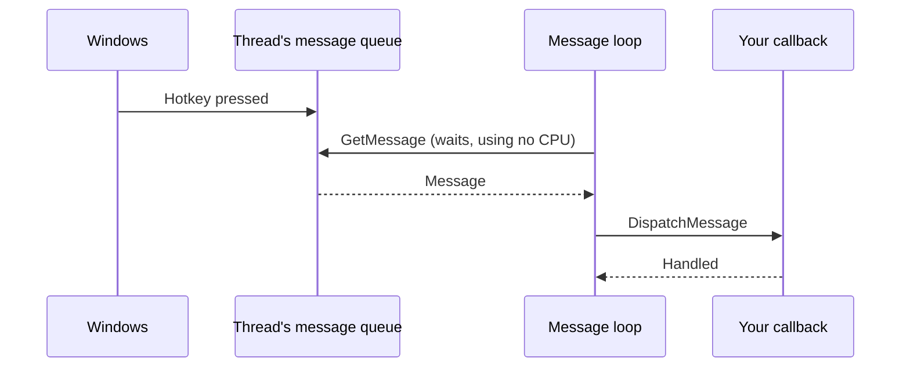
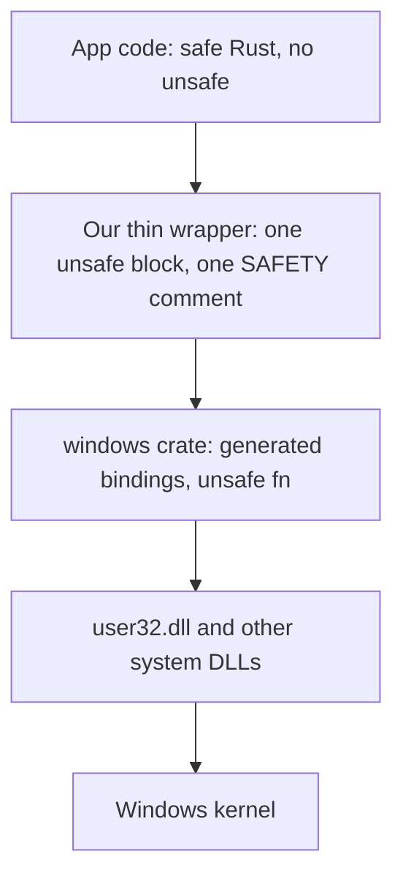

# Win32 and Rust: how they work together

A short guide for reading and reviewing this project's Windows code. It assumes no Windows API background
and little Rust. Signatures are from `windows` crate 0.62.2, the version in the spike's `Cargo.lock`.

## What Win32 is

Win32 is the C-style programming interface of Windows. It's a set of plain functions exported by system
DLLs such as `user32.dll` (windows, input, the cursor) and `kernel32.dll` (processes, threads, memory). Any
language can call them, because the calling convention is a stable, documented binary contract.

Five ideas cover almost everything this project touches:

| Idea | What it means | Where it shows up here |
|---|---|---|
| **Handle** | An opaque number that stands for something Windows owns, such as a window (`HWND`). You never see inside it. You pass it back to Windows. | The Overlay's `HWND` |
| **Window styles** | Bit flags on a window that change how Windows treats it. | `WS_EX_TRANSPARENT` (clicks pass through), `WS_EX_TOOLWINDOW` (no taskbar or Alt-Tab), `WS_EX_NOACTIVATE` (never takes focus) |
| **Messages** | Windows talks to a program by putting numbered messages in a queue: "mouse moved", "tray icon clicked", "hotkey pressed". | Tray, hotkey, display changes |
| **Message loop** | A loop on a thread that takes messages off that thread's queue and hands each one to a callback. Without it, nothing is delivered. A window belongs to the thread that created it. | Bevy's main thread, and the platform thread from Q11 |
| **Callback** | A function of yours that Windows calls. | Tray and event hook handlers |



The wait inside `GetMessage` is why event-driven code costs no CPU while nothing happens.

## How Rust calls it

Yes, a Win32 call goes in an `unsafe` block. But in idiomatic Rust you don't scatter those blocks around.
You confine them to small functions that hide them.

The call passes through these layers:



Microsoft generates the [`windows` crate](https://github.com/microsoft/windows-rs) from metadata that
describes the API, so we don't hand-write declarations. This is the binding for one function:

```rust
pub unsafe fn GetCursorPos(lppoint: *mut POINT) -> windows_core::Result<()>
```

Three things to notice:
- `*mut POINT` is a **raw pointer**, the C way of saying "write the result here". Rust's compiler can't
  check that a raw pointer is valid, unlike a normal reference.
- `unsafe fn` means callers must uphold rules the compiler can't verify, so the call must sit in an
  `unsafe` block. Nearly every Win32 function is marked this way.
- `Result<()>` is a convenience from the crate. It turns the C-style "returned false, now look up the error
  code" into an ordinary Rust error. `windows_core::link!` is what binds the function to `user32.dll`.

### What `unsafe` actually means

`unsafe` doesn't switch off the compiler's checks. It
[allows a few extra operations](https://doc.rust-lang.org/book/ch20-01-unsafe-rust.html), such as calling an
`unsafe fn` or dereferencing a raw pointer, and the borrow checker still runs on everything else. The
keyword means: "the compiler can't prove this is sound, so I, the author, promise it is".

The bugs `unsafe` can let in are the ones the rest of Rust rules out: writing through a dangling pointer,
using a handle after it's freed, or two threads touching the same memory. That's why the code is kept small.

## The idiomatic pattern: a safe wrapper

A wrapper is a normal, safe function with a Rust-shaped signature. Everything unsafe stays inside it, so
nothing about pointers or handles leaks to its callers:

```rust
/// Current cursor position in physical pixels, or `None` when it can't be read,
/// for example on the lock screen.
pub fn cursor_position() -> Option<Point> {
    let mut pt = POINT::default();
    // SAFETY: `pt` is a live local for the whole call, and Windows writes to it only during the call.
    unsafe { GetCursorPos(&mut pt) }.ok()?;
    Some(Point { x: pt.x, y: pt.y })
}
```

The rest of the program calls `cursor_position()` and can't get it wrong. The signature also turns a hidden
failure into a value the caller must deal with. See the [Rustonomicon on foreign function
interfaces](https://doc.rust-lang.org/nomicon/ffi.html), which recommends this same shape.

## Rules for this project

1. **`pet-core` has no unsafe code at all, enforced by the compiler.** `#![forbid(unsafe_code)]` at the top
   of the crate makes any `unsafe` a build error.
2. **Unsafe lives only in `pet-platform/src/windows/`.** Bevy adapter code calls the safe wrappers.
3. **One operation per `unsafe` block.** Keep the block as small as the call itself.
4. **Every block has a `// SAFETY:` comment** saying why the promise holds. Clippy's
   [`undocumented_unsafe_blocks`](https://rust-lang.github.io/rust-clippy/master/index.html#undocumented_unsafe_blocks)
   lint can enforce this.
5. **Whatever needs cleanup is owned by a value.** Rust runs a type's `Drop` code when the value goes out of
   scope, so cleanup can't be forgotten:

   ```rust
   struct WinEventHook(HWINEVENTHOOK);

   impl Drop for WinEventHook {
       fn drop(&mut self) {
           // SAFETY: this value owns the hook, and `drop` runs exactly once.
           let _ = unsafe { UnhookWinEvent(self.0) };
       }
   }
   ```

   The `windows` crate's own `Owned<T>` does this for common handle types.
6. **Callbacks are `extern "system"` and stay tiny.** A callback only copies what it needs and sends it down
   a channel. A panic must never escape into Windows, because that aborts the process.
7. **A thread that owns a window runs a message loop,** and only that thread touches thread-bound objects.
   `tray-icon`'s `TrayIcon` isn't `Send`, so the compiler stops it being moved to another thread by mistake.
8. **Never block the thread that owns a window while waiting on a call that needs it.** Changing a window's
   styles from another thread waits for the owner to answer. In Bevy the owner is the main thread, which waits
   for every system in a frame, so a system making that call must run on the main thread (`NonSendMarker`).

## Testing consequences

Wrappers are thin, so they hold little logic worth unit-testing. The decisions move into `pet-core` as pure
functions that take plain values, which `cargo test` covers without Windows. What's left needs a test
against the real app, covered in [e2e-testing-and-fullscreen-events.md](e2e-testing-and-fullscreen-events.md).
